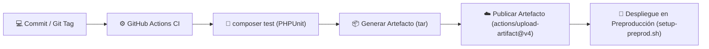

# 🥖 Sistema de Inventario de Panadería - "MikePan"

[](https://github.com/MIGUELAGV02/PanMike/actions/workflows/ci.yml)
[](https://php.net)
[](https://laravel.com)
[](https://sqlite.org)
[](LICENSE)

---

## 📌 Datos de Identificación del Estudiante
- **Nombre / Usuario de GitHub:** `MIGUELAGV02`
- **Correo Institucional:** `al222210644@gmail.com`
- **Repositorio Oficial:** [https://github.com/MIGUELAGV02/PanMike](https://github.com/MIGUELAGV02/PanMike)
- **Asignatura:** DevOps y Entrega Continua - Actividad de Liberación de Versiones (Unidad II)

---

## 📖 Descripción del Proyecto
**MikePan** es una solución integral desarrollada en Laravel 11/PHP diseñada para la administración de inventario y registro de existencias en una panadería artesanal. Utiliza **SQLite** como motor de base de datos embebido en el servidor local (sin requerir gestores externos ni consumo excesivo de memoria), lo que lo convierte en un sistema altamente portable, ligero y rápido.

---

## 🚀 Proceso de Integración y Entrega Continua (CI/CD)
El proyecto cuenta con un pipeline automatizado en **GitHub Actions** (`.github/workflows/ci.yml` y `.github/workflows/release.yml`) que no sólo valida el código mediante pruebas automatizadas, sino que además ejecuta las etapas de **liberación continua**, produciendo un **artefacto empaquetado (`laravel-release.tar.gz`)** listo para preproducción.



---

## 📂 Entregables de la Actividad

| Sección de la Actividad | Documento / Recurso | Descripción |
| :--- | :--- | :--- |
| **Parte 1: Diseño del Proceso de Liberación** | [`docs/DISENO_PROCESO_LIBERACION.md`](docs/DISENO_PROCESO_LIBERACION.md) | Pasos de preparación, dependencias, SemVer (`v1.0.0`), Quality Gates y diagrama Mermaid detallado. |
| **Parte 2: GitHub Actions (Workflow)** | [`.github/workflows/ci.yml`](.github/workflows/ci.yml) & [`.github/workflows/release.yml`](.github/workflows/release.yml) | Pipeline ampliado con pasos obligatorios: `Generar artefacto de liberacion` y `Publicar artefacto`. |
| **Parte 3: Ambiente de Preproducción** | [`setup-preprod.sh`](setup-preprod.sh) & [`.env.preprod.example`](.env.preprod.example) | Script bash automatizado y parámetros de configuración para servidores Ubuntu/Debian (Nginx/Apache). |
| **Parte 4: Validación del Artefacto** | [`docs/GUIA_PREPRODUCCION_Y_VALIDACION.md`](docs/GUIA_PREPRODUCCION_Y_VALIDACION.md) | Descarga desde GitHub Actions, auditoría de exclusión de `.env` / `.git`, despliegue y smoke tests. |

---

## 🛠️ Requisitos de Ejecución
- **PHP** >= 8.2 (Extensiones: `pdo_sqlite`, `sqlite3`, `mbstring`, `curl`, `xml`, `bcmath`, `fileinfo`, `zip`).
- **Composer** 2.x
- **SQLite 3**
- **Nginx** o **Apache**
- **tar** y **gzip**

---

## 💻 Inicio Rápido en Modo Local

1. Clonar el repositorio:
   ```bash
   git clone https://github.com/MIGUELAGV02/PanMike.git
   cd PanMike
   ```

2. Instalar dependencias:
   ```bash
   composer install
   ```

3. Configurar entorno y base de datos SQLite:
   ```bash
   cp .env.example .env
   php artisan key:generate
   touch database/database.sqlite
   php artisan migrate
   ```

4. Ejecutar suite de pruebas automatizadas:
   ```bash
   php artisan test
   ```

5. Iniciar servidor local:
   ```bash
   php artisan serve
   ```
   Acceder a la interfaz de inventario en: [http://localhost:8000/inventory](http://localhost:8000/inventory)

---

## 📦 Instrucciones para Despliegue en Preproducción

1. Descarga el archivo `laravel-release.tar.gz` desde los artefactos de la ejecución en GitHub Actions.
2. Descomprímelo en el servidor de preproducción:
   ```bash
   sudo mkdir -p /var/www/mikepan
   cd /var/www/mikepan
   tar -xzf laravel-release.tar.gz
   ```
3. Ejecuta el script automatizado:
   ```bash
   chmod +x setup-preprod.sh
   sudo ./setup-preprod.sh www-data
   ```
4. El script configurará automáticamente permisos (`775`/`664`), variables de entorno, migraciones en SQLite y cachés optimizadas.
